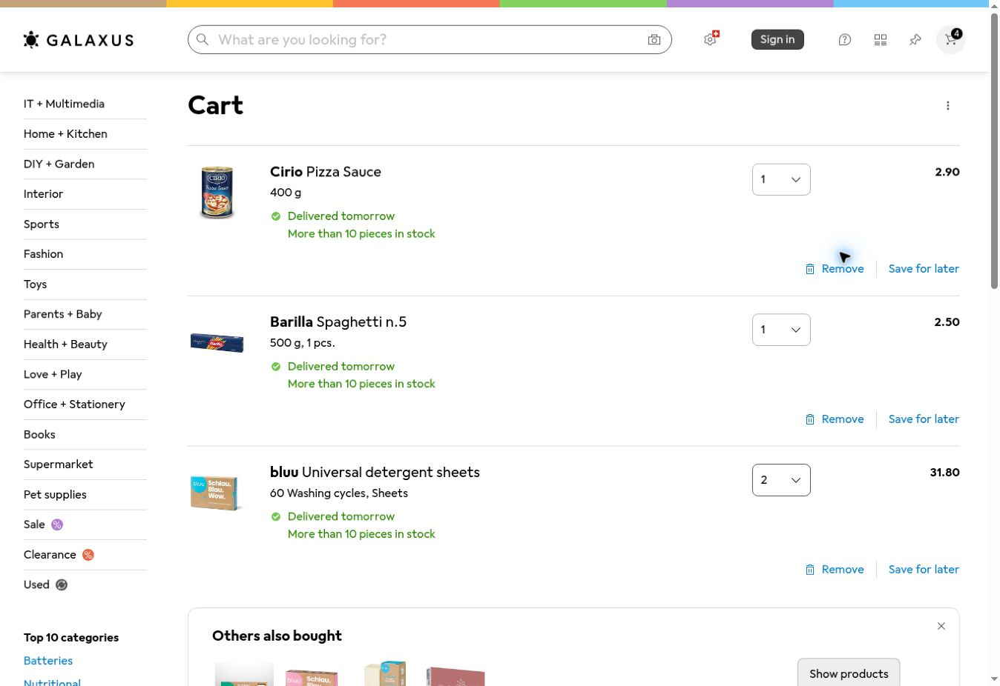
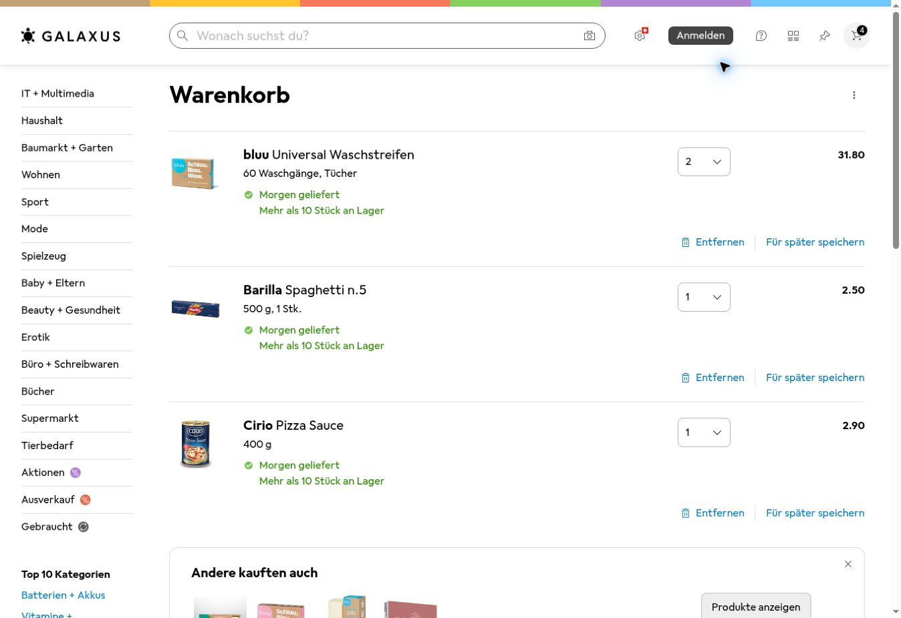

# JayJay: Browserpilot

Stand 02.11.2026. Ausgangspunkt: Laufzeitbranch `feat/household-shopping`,
PR #8 ist gemergt und das schwebende Chatfenster vom Nutzer bestaetigt.
Der bestehende API-Schluessel wird wiederverwendet. Layout bleibt ausserhalb
dieses Arbeitsschritts.

Die anschliessend vorbereitete isolierte Anmeldeschicht und ihre Grenzen
sind in [SHOP_LOGIN_PILOT.md](SHOP_LOGIN_PILOT.md) dokumentiert. Noch kein
echter Shop-Login und keine Einbindung dieser Maske in die gehostete PWA.

Die PWA-Einbindung ist inzwischen separat implementiert, aber noch nicht
bereitgestellt oder aktiviert: [SHOP_LOGIN_PWA.md](SHOP_LOGIN_PWA.md).
Sie verwendet persoenliche, dauerhaft referenzierte Auftraege und einen
separaten Pilotdienst; das lokale Loopback-Portal wird nicht oeffentlich
exponiert. Noch kein weiterer echter Login-/API-Test.

## Aktueller Stand: echter Agents-API-Warenkorbtest erfolgreich

Nach der ausdruecklichen Freigabe "Ich erlaube diesen einmaligen API-Test ohne
hartes Geldlimit" wurde exakt ein prepare-Lauf mit dem vorhandenen Schluessel
ausgefuehrt. Der Aufruf erfolgte aus der Entwicklungsumgebung; Browser und
Agent liefen in einer neuen OpenAI-gehosteten Sitzung mit `gpt-6-astra`.
Kein manueller Eingriff ueber CUA in diesen API-Lauf.

Der Hauptturn schloss innerhalb des vorgesehenen Beobachtungsfensters ab:
`turn_completed`, 25 abgeschlossene Browseraufrufe, vier erhaltene Screenshots.
Der letzte gespeicherte Screenshot wurde separat vom aufrufenden Assistenten
visuell geprueft. Er zeigt genau diese drei Zeilen und Mengen:

| Produkt | Packung | Galaxus-ID laut Agentenbericht | Sichtbare Menge |
| --- | --- | --- | --- |
| Cirio Pizza Sauce | 400 g | 37264242 | 1 |
| Barilla Spaghetti n.5 | 500 g | 14730798 | 1 |
| bluu Universal detergent sheets | 60 Waschgaenge | 14684120 | 2 |



Namen, Packungen und Mengen sind im Bild sichtbar. Die Artikelkennungen
stammen aus dem Agentenbericht und den darin genannten Produktlinks, nicht
aus dem Screenshot. Der Agent berichtete einen leeren Ausgangswarenkorb;
auch der erste waehrend des Laufs separat betrachtete Screenshot zeigte
einen leeren Gastwarenkorb. Keine anderen Positionen wurden uebernommen.

Der Agent meldete, er habe den Warenkorb offengelassen. Das beschreibt nur
den letzten Browserzustand: Der aufrufende Code hat anschliessend die
Sitzung wie vereinbart geloescht; die API bestaetigte die Loeschung
(`cleanup=deleted`). Der Gastwarenkorb ist damit keine dauerhafte Uebergabe
und nicht auf dem persoenlichen Geraet verfuegbar. Keine Anmeldung, kein
Checkout und keine Bestellung. Keine automatische Wiederholung gestartet.

Die einmalige Freigabe ist verbraucht. Tatsaechliche Kosten dieses einzelnen
Laufs wurden nicht separat abgerufen oder verifiziert; ein fester Geldbetrag
war ausdruecklich nicht garantiert. Dieser kleine Funktionsnachweis belegt
keine statistische Zuverlaessigkeit, sichere Anmeldung, Wiederholungsfestigkeit,
Geraeteuebergabe oder Ausfuehrung aus Railway. Der laufende James-Chat wurde
nicht geaendert oder mit einem Browserwerkzeug verbunden.

## Einzeltest: ausdruecklich freigegeben und erfolgreich ausgefuehrt

Die Nutzer-Screenshots bestaetigen fuer das einzige API-Projekt (Default
project) ausdruecklich "Ausgabenlimit nicht verfuegbar". ChatGPT-Projekte
sind keine API-Projekte. Die bisherige Anleitung zum Projekt-Kostenlimit
passte nicht zur tatsaechlichen Kontooberflaeche.

Als gesonderte Option ist jetzt ein einmaliger Test vorbereitet, der **nur
nach ausdruecklicher Freigabe des fehlenden harten Geldlimits** verwendet
werden darf. Der normale Modus verlangt weiterhin das serverseitige Limit.
Die Option `--authorize-single-test-without-hard-cost-cap` gilt ausschliesslich
fuer eine neue prepare-Sitzung. Keine Wiederholung, keine Anmeldung, kein
Checkout, keine Bestellung und keine Sitzungsaufbewahrung. Nach maximal
360 Sekunden Beobachtung wird eine Cancellation ueber
`agent.session.input.cancel` angefordert; danach wird die Sitzung geloescht.
Auch bei fruehem Abschluss wird sie geloescht. Netzwerkfehler koennen
Abbruch/Bereinigung verzoegern oder verhindern; ein fester Geldbetrag wird
dadurch **nicht** garantiert. Offene Bereinigung muss gemeldet werden.

Die Option wurde zunaechst nur mit Mocks getestet. Anschliessend gab der Nutzer
den einmaligen API-Test ohne hartes Geldlimit ausdruecklich frei (Ergebnis unten).
Diese Freigabe darf nicht als
dauerhafte Erlaubnis fuer weitere Tests oder unbegrenzte Ausgaben interpretiert
werden. Die vorherige automatische Ablehnung wird damit nicht umgangen:
Eine Ausfuehrung benoetigt neue, konkrete Nutzerautorisierung und die
erneute Werkzeugpruefung.

## Erster Nachweis: Gastwarenkorb ueber CUA praktisch bestaetigt

Der Nutzer hat die Produktauswahl fuer den Proof of Concept ausdruecklich
delegiert. In der verfuegbaren ChatGPT-Browserschnittstelle (CUA), **nicht aus
James oder Railway und nicht ueber die Agents API**, wurden folgende Produkte
in einen zuvor leeren, nicht angemeldeten Galaxus-Warenkorb gelegt:

| Produkt | Packung | Galaxus-ID | Ziel / beobachtet |
| --- | --- | --- | --- |
| bluu Universal Waschstreifen, Alpen Frische | 60 Waschgaenge | 14684120 | 2 / 2 |
| Barilla Spaghetti n.5 | 500 g | 14730798 | 1 / 1 |
| Cirio Pizza Sauce | 400 g | 37264242 | 1 / 1 |

Alle drei Zeilen und Mengen wurden direkt in der Warenkorboberflaeche gelesen
und in einem Screenshot bestaetigt. Nach einem vollstaendigen Neuladen waren
dieselben drei Produkte mit 2/1/1 weiterhin vorhanden. Fuer einen wiederholten
Auftrag waren damit keine weiteren Add-Aktionen erforderlich. Das belegt den
manuell vom Agenten eingehaltenen Sollmengenabgleich; ein automatischer
Replay-/Parallelitaetstest der James-Implementierung ist es noch nicht.



Die Anzeige am Warenkorbsymbol zaehlt Stuecke, nicht unterschiedliche
Positionen. Fuer die Abnahme sind die drei Warenkorbzeilen massgeblich.
Ein Klick aus der Suchliste wurde nicht als gespeicherte Position bestaetigt;
nach Lesen des Warenkorbs wurde das fehlende Produkt ueber seine eindeutige
Detailseite hinzugefuegt. Es entstand keine doppelte Position.

Keine Anmeldung, keine persoenlichen Daten, kein Checkout und keine Bestellung.
Der Gastwarenkorb wurde fuer die Sichtpruefung offengelassen. Seine URL
`https://www.galaxus.ch/de/cart` uebertraegt weder Cookies noch Warenkorbinhalt
auf das persoenliche Geraet. Das bleibt ein eigener Test.

## Fruehere Agents-API-Grenze vor der Einzelgenehmigung

Ein neuer Cart-Pilot mit `spend_control={"limit":300}` wurde mit HTTP 400,
`unknown_parameter`, Parameter `spend_control` abgelehnt. Die aktuelle offizielle
[API-Referenz](https://developers.openai.com/api/reference/python/resources/beta/subresources/agents/subresources/sessions/methods/create)
dokumentiert das Feld in US-Cents; der tatsaechliche Endpunkt akzeptiert es
bei diesem Zugang jedoch nicht. Ohne Limit wurde der weitere Versuch durch
die automatische Sicherheitspruefung wegen moeglicher unbegrenzter
API-/Sandboxkosten abgelehnt. Dieser Weg wurde nicht umgangen.

Die anschliessende reine API-Bestandspruefung fand keine Cart-POC-Sitzung mit
den eindeutigen Pilotinstruktionen. Bis zur nachfolgenden Einzelgenehmigung war kein API-Warenkorbauftrag
nachgewiesen. Die Browserprobe verlangt jetzt vor jeder Eingabe ein vom
Server zurueckgeliefertes Limit von hoechstens 300 US-Cents. Eine neu erzeugte
Sitzung ohne bestaetigtes Limit wird wieder geloescht, auch wenn Aufbewahrung
angefordert wurde. Kein stiller Fallback auf unbegrenzte Sitzungen.

Das vorbereitete Betreiberwerkzeug `scripts/jayjay_cart_poc.py` bietet die
Phasen `prepare`, `recheck`, `verify` und `close` in derselben Sitzung. Der ausdruecklich freigegebene prepare-Einzeltest ist inzwischen live
abgenommen; recheck/verify und der normale Modus mit serverseitigem Limit
sind weiterhin nicht live abgenommen. Ohne gesonderte Freigabe startet der
normale Modus wegen der Kosten-Grenze keinen Warenkorbauftrag. Keine Anbindung als Chatwerkzeug oder Webroute.
Das Budget gilt pro Sitzung, die sechs Minuten sind nur das Beobachtungsbudget
pro Turn; sie sind keine Garantie, dass ein unterbrochener Serverturn endet.

Naechste Integrationsarbeit: eine nachweislich begrenzte API-/Browserlaufzeit
waehlen, sichere interaktive Anmeldung ermoeglichen, den Warenkorbzustand
strukturiert gegen einen fixierten Auftrag abgleichen und die Uebergabe in
das persoenliche Shopkonto testen. Der heutige Shoptest belegt den UI-Weg,
ersetzt aber keinen dieser Integrationsnachweise.

## Erster technischer Nachweis

Die Agents API hat mit dem vorhandenen Zugang eine Sitzung mit
`environment.type=openai_hosted`, `desktop.enabled=true` und `computer_use`
erstellt. Ein echter Modelllauf mit `gpt-6-astra` hat die oeffentliche
Coop-Adresse `https://www.coop.ch/de/p/3032108` im gehosteten Browser aufgerufen.
Der Screenshot zeigt die Coop-Sperrseite **Access is temporarily restricted**
mit Hinweis auf ungewoehnliche Aktivitaet. Produktname und Packung konnten
nicht geprueft werden. Kein Anmeldeversuch, kein Warenkorbeingriff, keine
Bestellung. Die Sitzung wurde nach dem abgeschlossenen Lauf geloescht.

Das ist ein Nachweis fuer Agents-/Browserzugang, kein erfolgreicher
Coop-Produkttest. Die Sperre wurde nicht umgangen oder automatisch erneut
angefragt. Ausfuehrungsort des aufrufenden Prozesses: Entwicklungsumgebung,
Browser: OpenAI-gehostet. Kein Nachweis aus Railway.

Galaxus wurde danach in zwei getrennten, rein lesenden Sitzungen geprueft.
Jeweils vier `computer_use_call`-Abschluesse und ein abgeschlossener Hauptturn
wurden beobachtet. Beide Modellberichte nennen bluu Universal Waschstreifen,
60 Waschgaenge / 164 g, Artikelkennung 14684120 und Herstellerkennung BLUU001.
Die finale Adresse lautet:
`https://www.galaxus.ch/de/s7/product/bluu-universal-waschstreifen-60-waschgaenge-tuecher-waschmittel-textilpflege-14684120?openBlocks=specifications`.
Der zweite Lauf pruefte die Screenshot-Erfassung nach Erweiterung um PNG.
Trotz aktivierter Screenshot-Option lieferte auch dieser Lauf keine Bilddaten.
Damit sind Browseraktivitaet und uebereinstimmende Modellberichte beobachtet,
die Produktdaten aber nicht unabhaengig am Bild verifiziert. Beide Sitzungen
wurden geloescht. Keine Anmeldung, kein Warenkorbeingriff, keine Bestellung.

## Reproduzierbare oeffentliche Probe

`scripts/jayjay_browser_probe.py` ist ein isoliertes Betreiberwerkzeug und
besitzt keine Verbindung zu Haushaltsdatenbank, Chat oder Shop-Sitzungen.
Die optionale SDK-Abhaengigkeit steht in `requirements-browser.txt` und wird
nicht in den Web-Service eingebaut.

```bash
python -m pip install -r requirements-browser.txt
# Vorhandenen OPENAI_API_KEY sicher in der Prozessumgebung bereitstellen.
python scripts/jayjay_browser_probe.py 'https://www.coop.ch/de/p/3032108' \
  --state /tmp/james-browser-probe-new.json \
  --screenshot /tmp/james-browser-probe-public.jpg
```

Die explizit angegebene Adresse gibt nur ihren exakten HTTPS-Origin frei.
Andere Origins werden abgelehnt, Anmeldeanforderungen abgebrochen. Es gibt
keine automatischen HTTP-Wiederholungen. Eine bestehende Zustandsdatei wird
nicht ueberschrieben; ein unklarer Lauf wird nicht einfach wiederholt.
Sitzungs-ID und Ergebnis werden vor/nach dem Auftrag in einer privaten
Datei gespeichert. API-Ausnahmen liefern nur den Typ, keine Rohantworten.
Das Beobachtungsbudget betraegt 120 Sekunden; HTTP-Anfragen haben 30 Sekunden
Timeout. Abschliessend wird die Sitzung auch bei Fehlern geloescht.
Bei `cleanup=pending` bleibt die Sitzungs-ID fuer manuelle Nachpruefung
erhalten. Bei `creation_outcome_unknown` zuerst die vorhandenen Sitzungen
pruefen, keinen neuen Lauf automatisch starten.

`turn_completed` bedeutet nur: Hauptturn abgeschlossen und Browseraufrufe
beobachtet. Die Modellmeldung ist **kein Produkt- oder Warenkorbnachweis**.
Screenshot und Shopzustand separat pruefen. Nicht fuer angemeldete Seiten
oder echte Warenkorbaenderungen verwenden. Ein Browserlauf verursacht
API-/Sandboxkosten. Neue Sitzungen verlangen inzwischen ein bestaetigtes
API-Limit von hoechstens 300 US-Cents; am aktuellen Endpunkt ist dieser Start
blockiert (siehe oben).

## Naechster Warenkorbtest

Die urspruengliche Uebergabe enthielt keine drei verbindlichen Testprodukte.
Der Nutzer hat die Auswahl anschliessend delegiert; die obige Dreierliste ist
fuer weitere POC-Laeufe fixiert. Fuer einen persoenlichen Einkauf spaeter klaeren:

1. Shop und drei exakte Varianten/Packungen, vorzugsweise Produktlinks.
2. Jeweilige Packungszahl; mindestens eine Position mit Menge 2.
3. Bewusst eingerichtete persoenliche Shop-Anmeldung. Keine Cookies aus
   ChatGPT oder dem persoenlichen Browser uebernehmen.

Vor jeder Aenderung den vorhandenen Warenkorb lesen. Fuer die drei Positionen
Zielmengen vereinbaren, vorhandene andere Positionen bewahren, Mehrmengen
nicht still reduzieren. Nach unklarer Antwort erst Zustand lesen, keine
erneute Add-Aktion. Bei Mehrdeutigkeit, Nichtverfuegbarkeit oder abgelaufener
Sitzung anhalten und den offenen Punkt melden. Abschliessend genaue
Artikelkennungen, Packungen und Mengen im Warenkorb sowie die Sichtbarkeit
auf dem persoenlichen Geraet nachweisen. Erst danach als JayJay-Werkzeug
anschliessen. Kein Bestellabschluss.

Die gehostete Browserfreigabe gilt pro Origin, nicht pro Klick. Sie erzwingt
technisch keine gesonderte Checkout-Bestaetigung. Ein instruktionsbasiertes
Checkout-Verbot darf deshalb nicht als technische Zahlungssperre beschrieben
werden. Vor einer produktiven Einkaufsfunktion diese Grenze loesen, zum
Beispiel durch eine kontrollierte Laufzeit mit gesperrten Bestellaktionen.

## Offizielle Grundlage

- [Agents API Computer use](https://developers.openai.com/api/docs/guides/agents-api/tools/computer-use)
- [Agents API Quickstart](https://developers.openai.com/api/docs/guides/agents-api/quickstart)

Anmelde- und Websitefreigaben gehoeren in eine sichere Interaktion mit der
Person. Das Betreiberwerkzeug implementiert diese Anmeldung bewusst noch
nicht. Zugang zur Agents API ersetzt weder diese Interaktion noch die
Warenkorbabnahme.

## Lokale Validierung

Ergaenzung nach Cart-POC: 16 Browser-Lifecycle-Tests bestanden, einschliesslich
Sitzungswiederverwendung, beschaeftigter Sitzung und Verweigerung/Bereinigung
bei fehlendem Kostenlimit. Der bisherige PR-Stand hatte ausserdem eine
erfolgreiche GitHub-CI einschliesslich Postgres und Containerpruefung.
Die nachfolgende Liste beschreibt den frueheren ersten Prueflauf.

- Neue isolierte Browserprobe: 12 Tests bestanden. Exakte Origin-Freigabe,
  Abbruch bei Anmeldung, fehlender Bild-/Browsernachweis, Verbindungsabbruch
  ohne Replay, private Zustandsdatei, getrennte Screenshot-Erfassung und
  fehlgeschlagene Bereinigung werden geprueft.
- Gesamtlauf: 159 Tests bestanden, neun Postgres-Tests uebersprungen. Drei
  Migrationstests scheiterten zunaechst am falschen Python im Unterprozess
  (Flask dort nicht installiert). Nach korrektem venv-PATH bestanden diese
  drei zusammen mit den zuletzt erweiterten 12 Browsertests: 15 bestanden.
- 25 JavaScript-Tests bestanden. Keine neue Datenbankmigration und keine
  Aenderung am Web-Service, Layout, Chat oder Railway-Konfiguration.
- Produktiver Shop-Warenkorb, Anmeldung, Wiederholungsverhalten und
  persoenliche Geraeteuebergabe sind noch nicht abgenommen.
